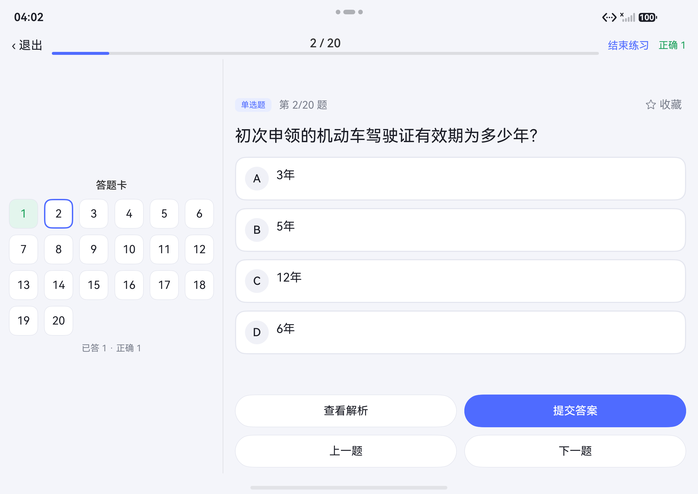
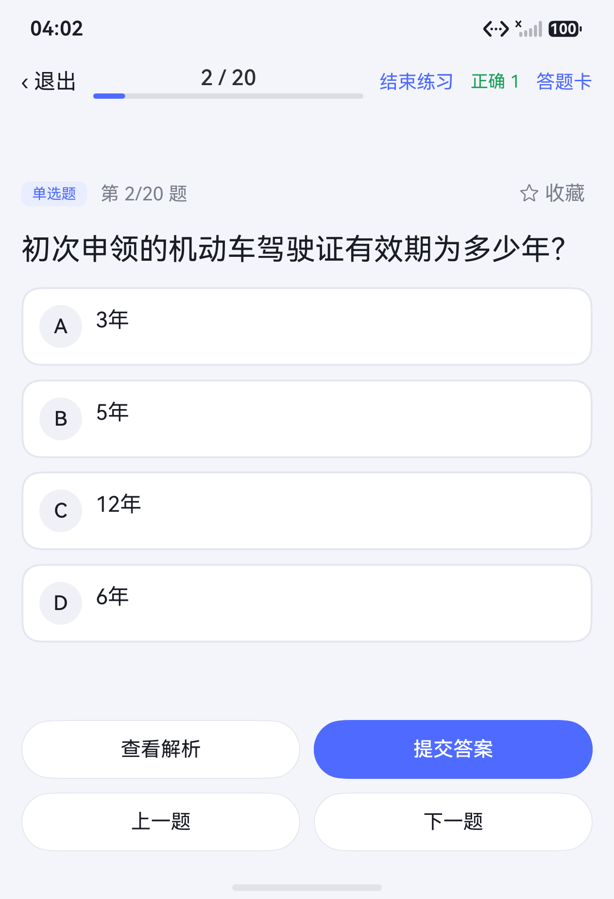

<p align="center">
  
</p>

<h1 align="center">Misaka Quiz</h1>

<p align="center"><strong>鸿蒙原生刷题工具</strong></p>
<p align="center">把 Word、Excel 和文本里的题目变成自己的题库。<br>随时接着练，也可以计时考试、集中复习错题。</p>

<p align="center">
  <a href="#构建与安装">构建与安装</a>　|　
  <a href="#开始刷题">开始刷题</a>　|　
  <a href="CHANGELOG.md">更新记录</a>
</p>

## 界面预览

<p align="center">
  <a href="docs/harmony/screenshots/practice-expanded.webp"></a>
  <a href="docs/harmony/screenshots/practice-folded.webp"></a>
</p>

阔折叠展开后，答题卡和题目并排显示。折叠后切回单栏，点「答题卡」即可跳题。界面支持浅色和深色模式。截图来自 WideFoldM4 模拟器。

## 开始刷题

1. 打开「导入」。点「导入内置 C1 题库」即可体验截图里的题库。
2. 导入自己的题库时，点「选择文件（可双文件）」。检查识别结果后，点「导入题库」保存。
3. 回到首页，点「开始练习」或「开始考试」，按需选择出题范围。退出练习后，可以从首页「继续练习」。

自己的题库可以参考 [示例文档](docs/标准题库格式示例/标准题库格式示例.docx) 和 [排版说明](docs/标准题库格式示例/标准题库格式示例.md)。

## 主要功能

- **题库导入**　读取 Word（DOCX）、Excel（XLSX）和 TXT，也可以直接粘贴题目。题目和答案分开保存时，可一次选择两个文件。支持预览修改和导入 DOCX 图片。
- **练习与背题**　支持单选、多选、判断、填空和简答。可以按顺序练习、随机抽题、打乱选项，或在背题模式下直接看答案。
- **模拟考试**　按题型设置题量和分值。支持答题卡跳题、倒计时交卷和成绩明细。
- **错题与收藏**　答错自动进入错题本。按题库、分组或题型缩小范围，再从筛选结果开练。错题还可以按掌握状态筛选。
- **AI 辅助**　配置服务后，可以核对导入结果、补充解析、分析单题或题库，也能围绕当前题目追问。在「我的 → AI 设置」中配置接口。
- **本地备份**　题库和学习记录保存在本机。可导出含图片的 ZIP 备份，在鸿蒙、Android 和 Web 版之间迁移。

鸿蒙版已实现系统练习接续，双真机验证待完成。[查看接续条件与验证范围](docs/harmony/练习接续.md)

## 构建与安装

鸿蒙版使用 ArkTS 和 ArkUI，项目目标与兼容 API 均为 26。源码在 [apps/harmony](apps/harmony)。

在 DevEco Studio 中打开 `apps/harmony`。启动模拟器后，选择 `entry` 模块运行。真机调试请先为项目配置签名。

也可以在仓库根目录用 DevEco CLI 构建。

```sh
cd apps/harmony
devecocli build
```

未配置签名时，构建会生成 `entry/build/default/outputs/default/entry-default-unsigned.hap`。这是本地构建产物。安装到真机前需要签名。

## 开发资料

- [鸿蒙移植进度](docs/harmony/移植进度.md)
- [题库解析与会话回归测试](test/harmony-parser-regression)
- [Android 原生版](https://github.com/Misaka-666/Misaka-quiz/tree/Android/apps/android)
- [Web 版源码和说明](apps/web)

在仓库根目录运行以下命令，即可检查鸿蒙版的题库解析。

```sh
node --import ./test/harmony-parser-regression/ts-node.mjs test/harmony-parser-regression/run-regression.mjs
```

---

项目源自 [reiqr/shiroha-quiz](https://github.com/reiqr/shiroha-quiz)，采用 [GPL-3.0](LICENSE) 许可证。
